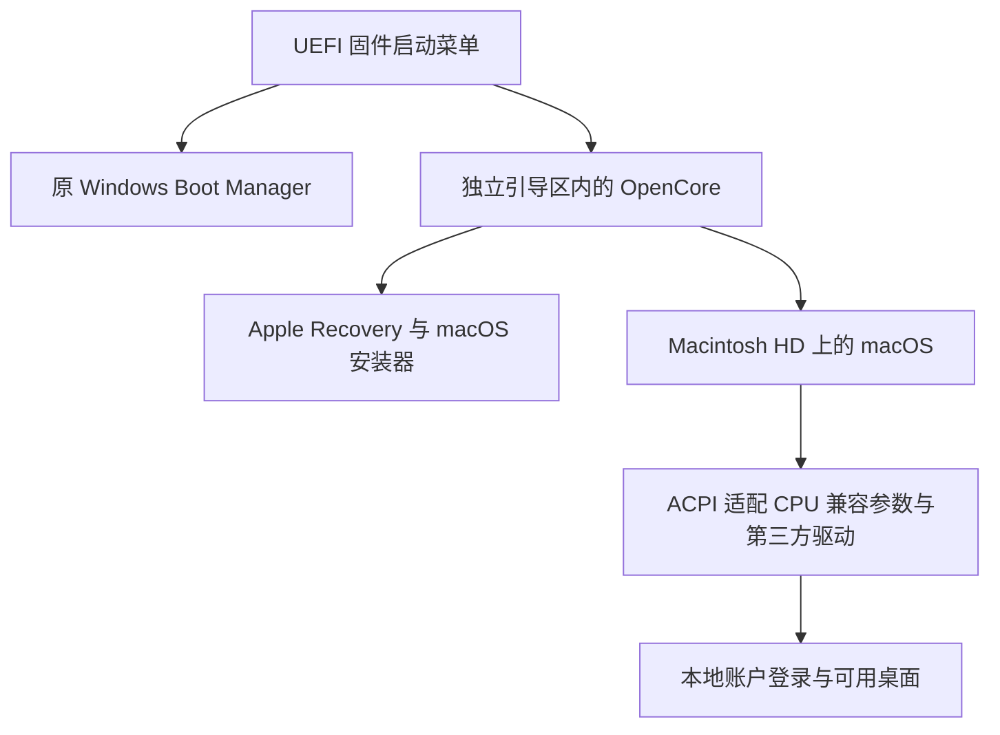

# Intel 13代 i9 + RTX 4060 成功安装 macOS Sequoia

本项目记录一台 **Intel Core i9-13900H + NVIDIA RTX 4060 Laptop** 笔记本，从硬件识别、无 U 盘双系统安装、启动故障排查，到安装显卡驱动后进入可用 macOS 桌面的实际过程。安装结果为 **macOS Sequoia 15.7.9，build 24G830**。

**这里的“成功”指本机安装完成、可登录桌面、Wi-Fi 可用，安装第三方 NVIDIA 2.5.4 驱动后机主反馈日常使用恢复正常。最终仍保留 `cpus=1`；Apple ID、AirDrop 和部分硬件功能没有全部解决。** 这不是适用于所有 13 代 i9 和所有 RTX 4060 的通用 EFI，也不是苹果或 NVIDIA 官方支持声明。

记录范围截止到原系统首次达到上述可用状态，不包含之后的存储扩容和分区迁移。当前默认启动 Windows，使用固件启动菜单进入 OpenCore；本次整理没有改变启动方式。

## 从哪里开始

- [完整安装与故障处理报告](docs/REPORT.zh-CN.md)：项目起点、技术路线、每个主要故障及最终结果。
- [安装与重装参考](docs/REINSTALL.zh-CN.md)：准备材料、安装阶段、账户与驱动处理顺序。
- [首次设置与账户恢复说明](docs/ACCOUNT-RECOVERY.zh-CN.md)：地区页卡死后实际采用的替代流程及校验条件。
- [功能状态和未解决问题](docs/STATUS.zh-CN.md)：避免把“有驱动”误写成“已全面测试”。
- [依赖版本、下载来源与校验和](docs/DEPENDENCIES.zh-CN.md)。
- [脱敏配置示例](config/README.md)和 [EC RTCM 修补源码](patches/README.md)。
- [脱敏证据摘要](evidence/summary.json)及[证据说明](evidence/README.md)。

## 实际硬件

| 项目 | 本机配置 |
|---|---|
| CPU | Intel Core i9-13900H，Raptor Lake H，6P + 8E，14 核 20 线程 |
| 独显 | NVIDIA GeForce RTX 4060 Laptop GPU，PCI `10DE:28E0` |
| 核显 | Intel Iris Xe，PCI `8086:A7A0`，没有取得其 macOS 加速验证 |
| 整机与主板 | Lenovo ThinkBook 16p G4 IRH，机型 21J8；LNVNB161216 |
| BIOS | LRCN52WW；本项目没有刷写 BIOS |
| 内存 | 16 GB；未据不完整信息推测 DDR 代际或条数 |
| SSD | Samsung MZVL21T0HCLR-00BL2，约 1 TB，NVMe，GPT |
| Wi-Fi | Intel AX203，PCI `8086:51F1` |
| 内屏 | 3200 × 2000；Windows 实测活动 eDP 内屏由 NVIDIA 输出，约 165 Hz |
| 原有系统 | Windows 11，UEFI 启动 |

机型和 BIOS 在正文中保留，是因为 ACPI、显卡输出线路和输入设备适配与它们有关。仅 CPU、显卡相同，不能证明能直接使用同一套配置。

## 技术路线



最终系统直接运行在本机硬件上。隔离虚拟机只用于读取副本、验证脚本和部分故障分析，不是最终交付的 macOS 运行方式。

项目采用 OpenCore、本机 ACPI 修补、Lilu/VirtualSMC 等扩展、AirportItlwm Sequoia 分支，以及通过 1401 Mac 工具原生安装的 NullMoth NVIDIA 2.5.4 驱动。`NootedGreen` 没有在最终可用 EFI 中启用。

## 最终状态摘要

| 功能 | 截止本报告终点的状态 |
|---|---|
| 安装和登录 | Sequoia 15.7.9 已安装，可通过 OpenCore 登录桌面 |
| Windows 保留 | 默认启动 Windows；原 Windows 加载器及 EFI 文件有前后核对记录 |
| Wi-Fi | 机主确认正常；系统登记为内置 `en0` |
| NVIDIA | 四个 2.5.4 扩展已安装落盘，机主确认安装驱动后正常使用；无独立 Metal 基准或长期负载认证 |
| CPU 性能 | **保留 `cpus=1`，不是完整 14 核 20 线程性能** |
| 首次设置 | 地区页原始卡死根因未彻底确认，最终经批准建立本地账户后绕过该设置流程 |
| Apple ID | 曾出现验证后界面与登录记录不一致，未完成最终闭环 |
| AirDrop | 机主反馈不可用 |
| 音频、睡眠、全部 USB 端口、触摸板手势 | 未完成逐项完整验收 |

## 仓库包含什么

包含文档、脱敏配置参考、原创小补丁、公开下载校验和及只读检查代码。**不包含完整系统镜像、账户数据库、密码、Apple ID、实际 SMBIOS 身份、原始 NVRAM、整套固件 dump 或个人系统备份。**

配置示例不是可以直接启动的完整安装包：需要自行取得匹配组件、生成自己的 SMBIOS 身份、检查本机 ACPI，并按实际磁盘重新确认目标。项目本地使用的 OpenCore 构建标识为 DBG109；本次没有找到可确认的官方 1.0.9 release 下载页，因此不伪造下载链接，也不分发来源无法完整追溯的该构建二进制。

第三方软件保持各自的许可证和维护归属。本仓库原创文档、独立示例和定制补丁采用 [MIT License](LICENSE)，不改变任何上游软件的授权。

## English summary

This repository documents a successful bare-metal macOS Sequoia 15.7.9 installation on one i9-13900H / RTX 4060 Laptop system. It includes the installation history, troubleshooting, sanitized configuration reference, a model-specific RTCM ACPI overlay, dependency links, and reinstall notes. **The working profile still uses `cpus=1`; Apple ID, AirDrop, full CPU performance, and complete peripheral validation are not claimed as solved.**

Run the repository-only checks with Python 3:

```text
python tools/validate_publication.py --self-test
python tools/validate_publication.py
```

These checks read repository files only. They do not mount disks, write EFI, modify boot entries, or create macOS accounts.
